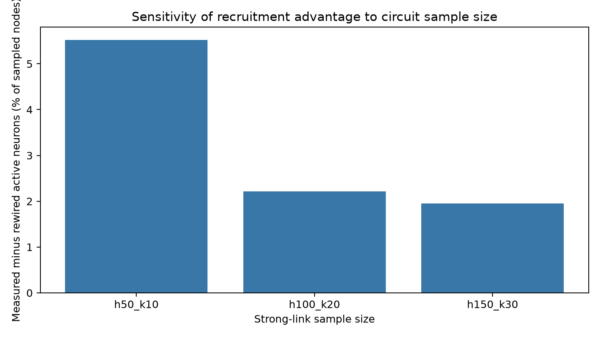

# Does fly brain wiring shape signal spread?

A reproducible computational neuroscience project exploring signal propagation in the adult *Drosophila* connectome. The project uses public FlyWire FAFB v783 connectivity and adapts leaky integrate-and-fire (LIF) model choices from Shiu et al. (2024).

> **Scope:** The reported simulations use small, strongest-link two-hop subnetworks. They are not whole-brain simulations and do not measure real neural activity. A full-connectome analysis is the next development phase.

## Question

In a sampled visual circuit around a cholinergic cM15 neuron, does measured wiring recruit more simulated downstream activity than degree-preserving rewired wiring?

## Current result

Across 10 paired trials at each of three nested sample sizes, the measured wiring produced more active downstream neurons in all 30 pairs. The mean paired gain was 22.7, 29.6, and 50.8 active neurons for samples containing 412, 1,338, and 2,600 neurons. As a share of sampled neurons, the gain was 5.5%, 2.2%, and 2.0%, respectively. The result is specific to the chosen neuron, sampling rule, and simplified model; it is not biological evidence.



See the [preliminary report](results/PRELIMINARY_REPORT.md), [sensitivity summary table](results/lif/sample_size_sensitivity.csv), and per-size comparison plots in `results/lif/`.

## Reproduce

### Requirements

Python 3.11 or newer is recommended. Install the listed packages:

```powershell
python -m pip install -r requirements.txt
```

### Data setup

Large connectome and annotation files are intentionally not stored in this repository. Download the v783 files from the [Shiu et al. model repository](https://github.com/philshiu/Drosophila_brain_model) and put them at:

- `data/Connectivity_783.parquet`
- `data/Completeness_783.csv`
- `data/annotations/neuron_annotations.tsv`

The FlyWire connectome data have separate terms from this repository's code; see [DATA_LICENSE.md](DATA_LICENSE.md). Use the data for noncommercial purposes and provide the required attribution.

### Run the paired sample-size study

From the project directory:

```powershell
python run_sensitivity.py --runs 10
```

This builds 50×10, 100×20, and 150×30 strongest-link samples, runs paired measured/rewired simulations with matched stimulus seeds, and writes summary tables and plots under `results/lif/`. Run `python run_project.py` for the default 100×20 analysis.

## Project layout

- `simulate_visual_hub.py` — streams the large connectivity table in batches and simulates sampled circuits.
- `simulate_whole_brain.py` — experimental full-v783 LIF pilot that streams connections into compact numeric arrays and adds Brian2 synapses in bounded chunks. It may still need several GB of available memory and can be slow on the NumPy backend.
- `run_sensitivity.py` — automates three sample sizes.
- `run_project.py` / `run_project.bat` — one-command default pipeline / Windows launcher.
- `analyze_connectome.py`, `label_hubs.py`, `compare_superclasses.py`, `inspect_visual_hubs.py` — connectome structure and annotation analyses.
- `summarize_spikes.py`, `compare_network_conditions.py` — summarize and compare simulation results.
- `reference-model/` — upstream Shiu et al. model source files with its license notice.
- `results/` — report, plots, and compact summary outputs; large raw inputs and event-level outputs are excluded.

## Next phase: scale toward the full brain

The data contain connectivity for about 138,639 neurons and more than 15 million directed neuron-pair connections. The first full-brain attempt exceeded available memory because the table was expanded into a large in-memory data frame. `simulate_whole_brain.py` now reads the edges in batches into compact numeric arrays and is the first full-network pilot. Start with one short run:

```powershell
python simulate_whole_brain.py --duration-ms 200
```

This is a resource-intensive exploratory run; stop it with Ctrl+C if memory use becomes excessive. The network connections are added in 250,000-edge chunks by default; lower `--connection-chunk-size` if setup still runs out of memory. It writes an event file and active-neuron table locally (ignored by Git), plus a compact run summary. If this still exceeds memory or takes too long, the next step is a sparse or neuropil-partitioned implementation. The small-subnetwork result remains a baseline, not a claim that full-brain scaling is solved.

## Sources and attribution

- Shiu et al. (2024), “A Drosophila computational brain model reveals sensorimotor processing,” *Nature*. [Paper](https://doi.org/10.1038/s41586-024-07763-9) · [Code](https://github.com/philshiu/Drosophila_brain_model)
- Dorkenwald et al. (2024), “Neuronal wiring diagram of an adult brain,” *Nature*. [Paper](https://doi.org/10.1038/s41586-024-07558-y)
- Schlegel et al. (2024), “Whole-brain annotation and multi-connectome cell typing of Drosophila,” *Nature*. [Paper](https://doi.org/10.1038/s41586-024-07686-5)
- FlyWire public release v783 [data and citation guidelines](https://join.flywire.ai/guidelines)

This is an independent educational project and is not affiliated with or endorsed by Google DeepMind, FlyWire, Princeton University, or the authors of the reference model.

