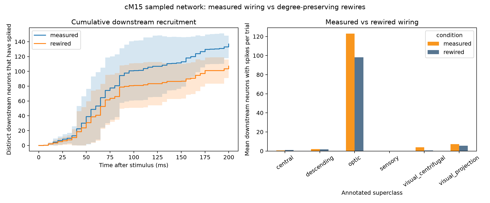
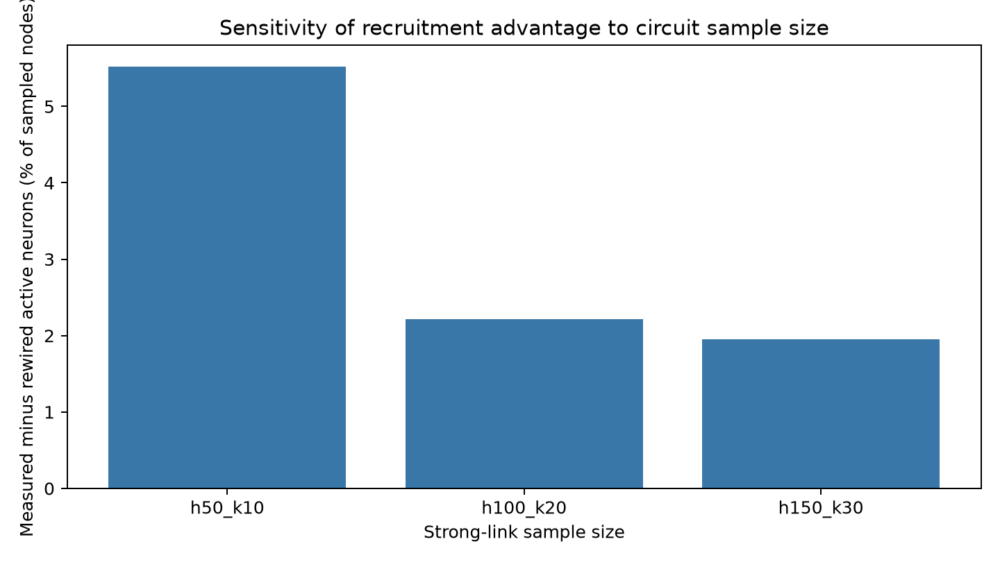

# Preliminary report: visual-circuit activity in a sampled fly connectome

## Research question

In a small sampled FlyWire circuit around an annotated visual-centrifugal cM15 neuron, does measured wiring recruit more downstream activity than degree-preserving rewired wiring?

## Data and approach

The connection table is FlyWire FAFB v783 from the public data files used by the [Shiu et al. Drosophila brain model](https://github.com/philshiu/Drosophila_brain_model). The source neuron is a cM15 cell annotated as visual centrifugal and acetylcholine. To keep the model within local memory, connections were streamed in batches. The sampled circuit retained the 100 strongest outgoing links from the source and up to 20 strongest outgoing links from each first-hop neuron, yielding 1,338 neurons and 2,094 connections.

The sampled graph was simulated with a Brian2 leaky integrate-and-fire model using parameter values from Shiu et al. Ten measured-network trials were paired with ten degree-preserving rewired trials. Each rewire preserves each node's in-degree and out-degree and retains the presynaptic weight values while changing partner assignments. Paired conditions used the same Poisson stimulus seed.

## Results

| Measure per 200 ms trial | Measured wiring | Rewired wiring | Paired difference |
|---|---:|---:|---:|
| Downstream neurons with spikes | 136.8 ± 8.57 | 107.2 ± 8.63 | +29.60 ± 10.34 |
| Downstream spikes | 502.0 ± 138.83 | 395.3 ± 114.60 | +106.70 ± 42.30 |

Measured wiring produced more downstream activity in all 10 paired trials. Activity was concentrated in visual classes: optic neurons averaged 123 active cells in measured wiring versus 98.2 in rewired wiring; visual-projection neurons averaged 7.2 versus 5.5; visual-centrifugal neurons averaged 4.0 versus 0.7. Central neurons averaged 0.6 versus 1.0, so the effect was not a uniform increase across every class.

## Interpretation

Within this particular sampled subnetwork and model, the measured partner assignments recruited more downstream activity than rewired partners with the same degree sequence. The difference was concentrated in optic and visual-related cell classes. This is a computational result about a reduced model, not evidence of real-time neural activity or behavior.

## Sensitivity to sample size

The paired comparison was repeated with three nested strongest-link cutoffs, using ten measured/rewired trial pairs at each size.

| First-hop links × links per first-hop neuron | Sampled neurons | Extra active neurons, measured minus rewired (mean ± SD) | Extra spikes (mean) | Positive pairs | Active-neuron gain / sample |
|---|---:|---:|---:|---:|---:|
| 50 × 10 | 412 | 22.7 ± 3.02 | 96.8 | 10/10 | 5.5% |
| 100 × 20 | 1,338 | 29.6 ± 10.34 | 106.7 | 10/10 | 2.2% |
| 150 × 30 | 2,600 | 50.8 ± 14.70 | 160.9 | 10/10 | 2.0% |

Across these three nested cutoffs, measured wiring recruited more active downstream neurons and produced more spikes in every paired trial. Absolute differences grew with sample size, while the active-neuron gain as a share of sampled neurons fell from 5.5% to about 2% and was similar for the two larger samples. This supports robustness to these particular cutoff choices; it does not establish robustness to other neuron selections, model parameters, or biological conditions.

## Limitations

- This is a two-hop subnetwork, not a whole-brain simulation.
- The sample keeps the strongest links, which biases it toward high-weight paths.
- The LIF model uses simplified dynamics and predicted transmitter signs.
- Ten trials estimate model variability for these runs; they do not capture biological variability.
- The result depends on one cM15 source and three nested strongest-link sampling cutoffs. Other selection rules, source neurons, and model parameters remain to be explored.
- The ten paired trials quantify variability across the simulator's random inputs for this setup; they are not independent biological replicates.

## Reproducibility

From the project folder, run `python run_sensitivity.py --runs 10`. This creates the three paired simulations and saves the sensitivity table and figure in `results/lif/`. The default 100 × 20 analysis can be rerun with `python run_project.py`.

## CV draft

Built a reproducible, memory-limited simulation of signal propagation in sampled FlyWire Drosophila visual circuits using a connectome-based leaky integrate-and-fire model; compared measured wiring with degree-preserving rewires across 30 paired trials and three network sizes, finding higher downstream recruitment in all pairs while documenting model and sampling limitations.

## References

- Shiu et al. (2024). *A Drosophila computational brain model reveals sensorimotor processing*. Nature. https://doi.org/10.1038/s41586-024-07763-9
- Shiu et al. model code (MIT): https://github.com/philshiu/Drosophila_brain_model
- FlyWire annotations: https://github.com/flyconnectome/flywire_annotations

